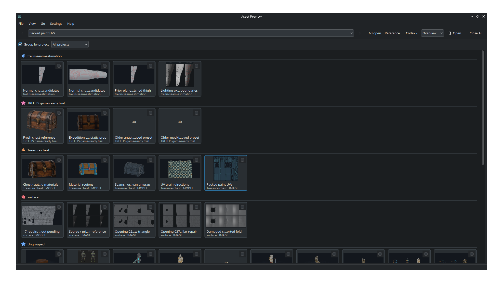
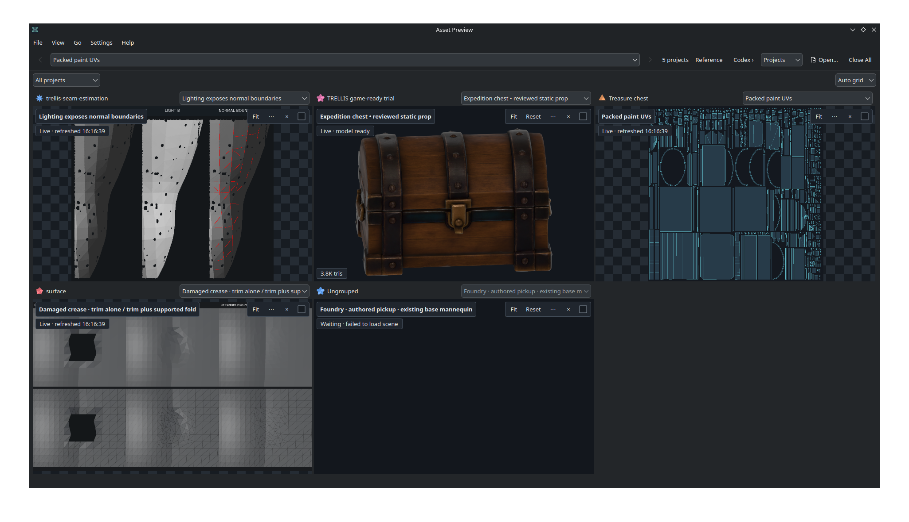
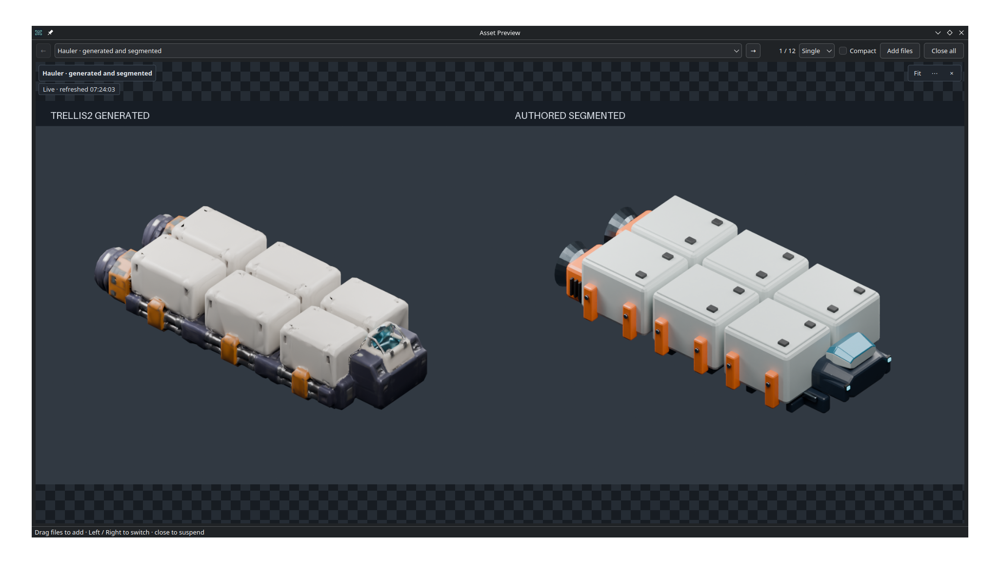
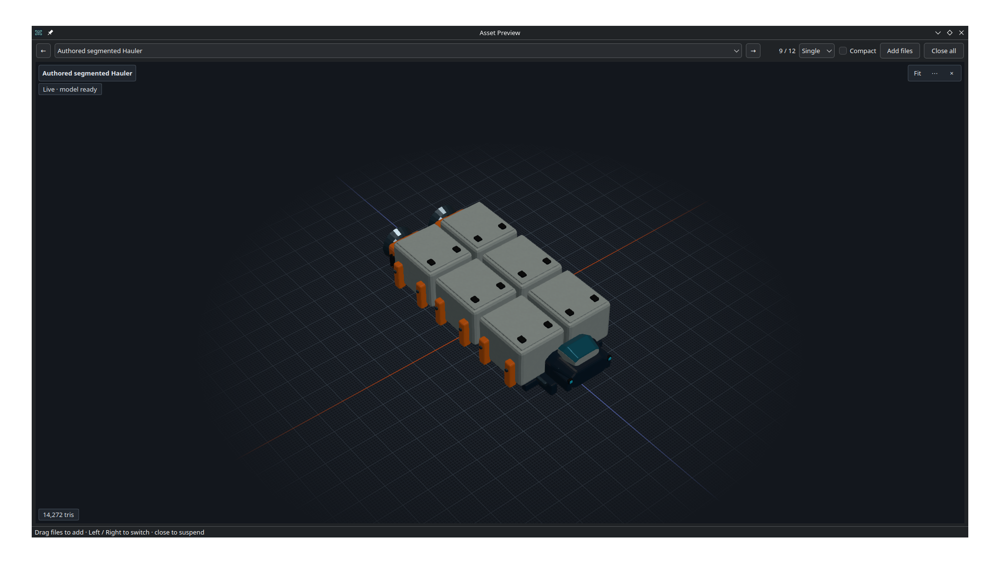
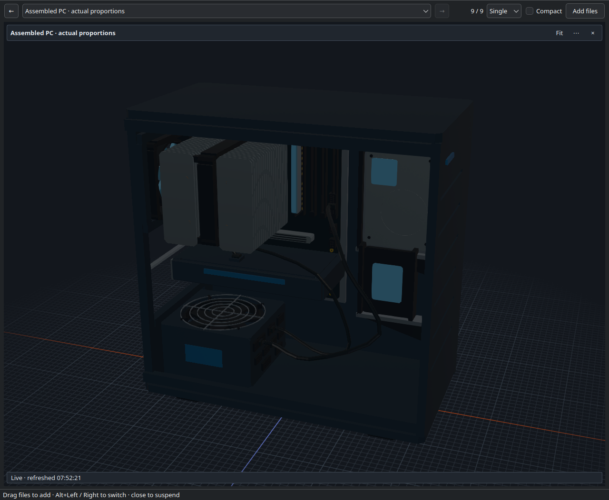
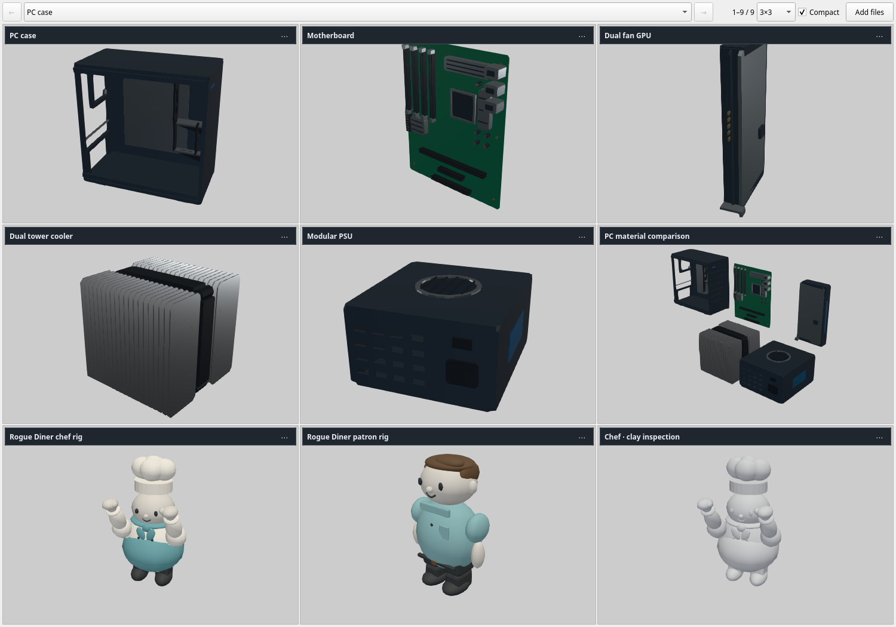
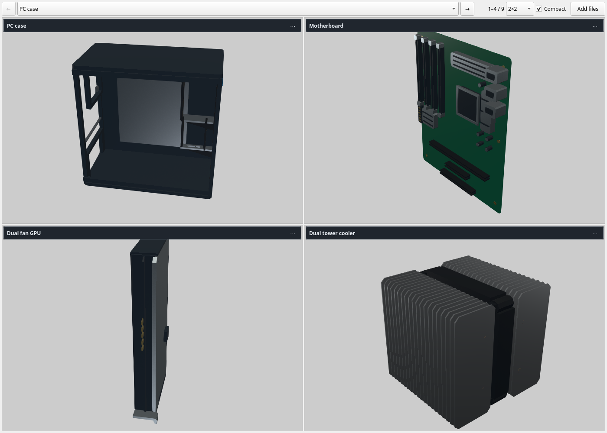

# Asset Preview

Projects group related agent outputs and keep one chosen current preview per
workstream. Choose **Projects** (Ctrl+9) for a controllable auto / 2×2 / 3×3 / 4×4
grid, or toggle **Group by project** and the project filter in **Overview**.
Create a group with `asset-preview project create chair --label "Chair"`, send
with `add FILE --project chair`, and use `--no-current` for supporting images.
Sends without an explicit project use the caller's owning checkout. See the
[project guide](skills/asset-preview/references/projects.md).

Live asset viewer for AI agent workflows. Keep the window open; agents register
images, audio/music, videos, 3D models and baked materials through the CLI or
[Codex skill](skills/asset-preview/SKILL.md). Previews refresh when files change.
Registration preserves window placement and selection.

Source builds with F3D 4 and a separately installed TRELLIS reader can
open `.post`, O-Voxel `.vxz` or lossless decoder `.ovoxel` files directly.
O-Voxel previews offer **Preview Options → O-Voxel View** with extracted raw
surface, raw voxel cells, occupied cell centers and decoded vertex positions.
Cells use their exact grid size; point markers scale with zoom. The same file
remains authoritative in every mode; see
[model support](specs/models.md) for the display and format boundaries.

Material recipes can also be presented as live graphs:
`./bin/asset-preview add /absolute/material.ptex --kind graph`.
The graph arranges saved connections automatically, with node thumbnails,
expandable parameters and a shaded saved-map preview; see
[material graphs](specs/material-graphs.md).

## Screenshots

Development checkout — Overview: related previews grouped by project.



Development checkout — Projects: current previews from several workstreams side by side.



Image preview: a comparison image of generated and authored segmented Hauler assets.



3D model preview: the authored segmented Hauler with a ground grid, axes and triangle count.



Single view: assembled PC from a three-quarter angle, showing components and cabling.



3×3 in dark mode: latest PC components, chef and customer rigs, and clay inspection.



2×2 in dark mode: current PC case, motherboard, dual-fan GPU and tower cooler.



## Downloads

[Release 0.0.2](https://github.com/RaresKeY/asset-preview/releases/tag/0.0.2):
AppImage, portable archive, Flatpak, `.deb`, `.rpm`, Arch package and `.run`.
See [Linux installation](docs/install-linux.md) for commands and requirements.
Private container: `ghcr.io/rareskey/asset-preview:0.0.2`.
[Dependency notices](THIRD_PARTY_NOTICES.md), corresponding sources and checksums
accompany the downloads. `asset-preview licenses` prints the notices.

## Build and install

Requires Linux, CMake 3.22+, a C++20 compiler, Python 3, Qt 6.4+
Widgets/Network/OpenGL, F3D 3.5+ with native and Assimp readers, and libmpv
headers/library (`pkg-config mpv`). Dependencies must already be installed.

```sh
./tools/build.sh
python tools/install.py
./bin/asset-preview
```

The installer adds a desktop entry, fish command/completion and the Codex skill.
Use `./bin/asset-preview` from other shells, or launch through `./play.sh`.
Installation points into this checkout; reinstall integration after moving it.

Crash reports persist in `~/.local/state/asset-preview/crash.log` (or the configured
`ASSET_PREVIEW_STATE_DIR`), with one rotated backup. Normal use writes no session
log; recent diagnostics stay in memory until a failure. Fatal reports retain
preview context and native fault details across restarts. An unreportable kill
or power loss is recorded as an unclean exit on the next launch.

Source launches use native Wayland (`QT_QPA_PLATFORM=wayland`) when the caller
provides `WAYLAND_DISPLAY`, and X11 (`xcb`) otherwise. Explicit platform
overrides are respected. `tools/test.sh wayland-gpu` checks rendering without
an X11 display in a private KWin compositor nested inside headless Gamescope.
That lane uses installed Spectacle to verify actual compositor pixels as well
as the source textures.
Published 0.0.2 packages retain their original X11/XWayland requirements.

## Commands

Examples use the installed fish command; otherwise use `./bin/asset-preview`.

```sh
asset-preview                                      # open the window
asset-preview chair.glb                            # open and select a file
asset-preview open texture.png "a song.wav"         # open several files; select the last
asset-preview add /path/to/chair.glb --id chair --label "Chair"
asset-preview add /path/to/texture.png --id texture
asset-preview add /path/to/turntable.mp4 --id turntable
asset-preview add /path/to/song.wav --id music       # MP3, FLAC, OGG, M4A and more
asset-preview settings music '{"paused":false}'     # start playing
asset-preview layout grid --size 3        # sizes: 2, 3, 4
asset-preview select chair
asset-preview status --json
asset-preview remove chair                         # preserves the file
asset-preview close-all                            # closes previews; keeps files/settings
```

The Fish function completes commands, file paths (including multiple files),
options and registered preview IDs. Press Tab after `asset-preview ` or
`asset-preview open `. Drag files from Dolphin into the window, onto an existing
preview, or onto its desktop launcher. **Open…** / **Ctrl+O** also accepts multiple
files. Opening selects the last file; reopening a path reuses its first registered
preview and keeps its generator, display settings and camera. Drops preserve the
original files. For filenames starting with `-`, use `asset-preview open -- FILE`.

Reusing an ID updates its registration. Files can be registered before they exist.
`start` starts the service without raising the window; `hide` suspends all views;
`stop` exits the service. Registrations, layout and all display/playback preferences
persist across restarts. New previews inherit the last-used image/audio/video/3D settings;
existing previews retain their own choices. **Close all** clears the previews while
keeping the window, files and remembered settings.

## Controls

**Settings > Theme > Auto / Dark / Light** changes the app's appearance immediately
and remembers it across restarts. Auto follows the system theme. Preview backgrounds
remain independent display settings.

| Preview | Controls |
|---|---|
| Image | Wheel zoom toward pointer, drag pan, fit, pixel filtering, checker/dark/light background |
| Model | Drag orbit, right/middle/Shift drag pan, wheel zoom around the existing focal point, double-click/Fit to frame, Reset for default camera, E edges, M triangle count |
| 3D scene / modular assembly | Load the authoritative assembled GLB as a model; inspect modules or owner-generated proof views alongside it |
| 3D animation / rig | Clip selector, play/pause, loop, speed, scrub timeline and stepped playback with frame rate; comma/period step frames, Space pauses, Home restarts |
| Audio / music | Music-reactive stereo ribbons and onset glow; play/pause, restart, elapsed/total time, click/drag timeline, mute and loop; Space/double-click pause, Shift+Left/Right seek, Home restart, M mute |
| Video | Playback bar with play/pause, restart, elapsed/total time, click/drag timeline, mute, loop and fullscreen; Space pauses, double-click toggles fullscreen, Shift+Left/Right seeks, Home restarts, M mutes |

**F11** or **View > Full Screen** puts the current layout fullscreen.
Double-clicking a video or using its fullscreen button expands that preview;
**Esc** or **F11** exits and restores the layout. An exit-shortcut notice stays
for three seconds, then slides up out of view. Video controls and the cursor hide
after 700 ms of inactivity and immediately on entering fullscreen. Move the
pointer or use the keyboard to reveal them; hovering controls, seeking and
keyboard focus keep controls available. The video bar has a thin teal timeline,
round playback buttons and a time pill, with secondary actions at the right.

The **⋯** menu provides display options, including clay/textured shading,
lighting, grid, axes, projection and Y/Z-up. Videos loop and start muted. Audio starts paused and unmuted, so pressing Play
starts listening. Audio/video preferences are remembered separately; explicit
`add --settings JSON` overrides them for that preview.
Audio visuals follow measured loudness, stereo balance and spectral brightness
from the playing track. They work while muted, settle during silence and freeze
when paused. Hidden and off-page players unload completely.
3D camera angle, pan and zoom are saved per preview across switching and restarts.
For texture-heavy GLBs, choose **⋯ > Model texture detail > Fast GLB preview ·
1024 px**, or run `asset-preview settings ID '{"texture_quality":"preview"}'`.
This uses a bounded cache of smaller embedded textures; the first use prepares
the cache. **Original** remains the default. Parts/Cuts always use the original
model and full-resolution textures. Unsupported files fall back to Original.
Animated GLB/glTF models start paused. Toggle **Stepped** to hold poses at a
chosen frame rate (12 fps initially). Previous/Next frame or comma/period pause
and move one frame. Options also expose these controls in narrow cards.
Transport settings stay with that asset;
static models have no playback bar or animation timer. Skeletal, node-transform
and morph clips are supported through F3D. For example:

```sh
asset-preview add /path/to/character.glb --id character \
  --settings '{"paused":true,"animation":0,"animation_speed":1,"loop":true}'
asset-preview settings character '{"paused":false}'
asset-preview seek character 0.75
```

`status --json` reports available `metrics.animations` and the effective clip,
duration and position. Clip indices are zero-based. Source replacement restarts
playback with stored transport choices; off-page/hidden views unload.

Image zoom and pan are saved too. Point at a preview to target its shortcuts and
menus, with no selection highlight. Outside the previews, the last active one
stays the target. **Ctrl+W** closes it; **Ctrl+Shift+T** reopens the
last closed preview with its settings and view (within the current session).
Closing shows the preview on its left, or the next one when closing the first.
**Settings → After Closing a Preview** switches between **Left Preview** and
**Last Viewed Preview** and remembers the choice. The return target preloads
eligible images into the bounded cache; other files receive a bounded read to
warm the OS cache, without starting hidden renderers, players or generators.

**Overview** in the layout picker, or **Ctrl+0**, shows all open assets as compact
thumbnails. Click a tile or press Enter to open it in Single view. Two image
workers and a separate model worker prepare thumbnails at low priority, with
visible images first. After a quiet period, nearby and other open assets warm
the bounded thumbnail cache, including while using Projects or Single view.
Loading ordinary previews pauses warming; hiding cancels it. Model/material jobs
render one finite offscreen frame. Other asset kinds reuse a frame from their
opened view. Thumbnail work starts no players or asset generators. Projects also
prefetches the next/previous member after settling on a visible project.

Small decoded images and waveforms reuse a bounded cache: **32 MiB per payload,
128 MiB total**, including a **16 MiB thumbnail allowance**. Self-pruning disk
derivatives total **256 MiB**. View → Clear Image and Thumbnail Cache clears small
derivatives; hiding the app releases retained RAM. [Cache details](specs/cache-overview.md).

`asset-preview cache` shows cache churn suspects and the log location.
`asset-preview cache events --json` shows recent admissions, unused evictions,
reloads after removal, pruning and heap reclamation with reasons and timings.
Diagnostics use bounded history and two rotating 256 KiB files; they add no idle
polling and omit repeated thumbnail paint-hit log lines.

**View → Camera Views** offers front/right/top/isometric with **1 / 3 / 7 / 9**;
Ctrl+1/3/7 gives the opposite view. Numpad keys also work. **F** fits and
**Ctrl+Home** resets the camera. **View → Compare With** opens two 3D previews
side by side; **Sync camera** links orbit, pan and zoom around each model.

**File → Save Screenshot** (**Ctrl+Shift+S**) saves image pixels with transparency, or the current rendered frame, to
**Pictures/Asset Preview**. **Copy Image / Frame** (**Ctrl+Shift+C**) copies just the
image pixels (including transparency) or the current rendered frame. **Copy View
Screenshot** keeps the current framing and background. File can also save the
entire window.

**Codex ›** opens the originating conversation in a resizable right sidebar.
The default split is 9:7 (preview/Codex); resizing preserves it, and dragging the
divider saves your preferred split.
Connect the asset from that Codex thread first. **Reference** (**Ctrl+Shift+A**)
freezes the view for optional circles, highlighting, numbered dots, pen and text.
**Window** in the sidebar captures the actual Preview interface. **Attach to
Codex** saves the PNG under Pictures/Asset Preview and inserts it into the draft;
add an explanation and send or queue it normally. Native **Ctrl+V** pastes images,
and **PNG…** attaches other files. Collapse/reopen preserves the draft. The
conversation stays pinned during navigation; **Follow asset** explicitly switches
to another asset's originating thread. Closing Preview leaves Codex background
work and queued prompts running. **File → Quit** ends terminal clients: wait for
Tab-queued prompts to drain before quitting the service. The terminal requires
installed Codex with Unix
remote attachment and the optional KF6 Parts / Konsole component.

Left/Right navigates previews or pages, matching the toolbar arrows;
Alt+Left/Right also works. Live, waiting, building and error status stays visible.
Only the current page is loaded. Minimizing or closing releases views and stops
their generators; closing leaves the service running.

Use the top-right checkboxes or Ctrl+click to select several previews, then
**Close selected (N)** in the toolbar. Shift+click selects a range; Ctrl+Shift+click
adds a range. Selection works in live grids and Overview and survives navigation.
**File > Close Selected Previews** also closes the checked items; Ctrl+W continues
to close the active preview. Ctrl+Shift+T reopens closed previews.

## Inspect 3D and leave comments

For static GLB/glTF models, choose **View > Inspect 3D** or use the model's
options menu. Models opened from the shell, Open dialog or a file drop also show
a toolbar selector: **Preview**, **Part mode**, **Cut mode**. Part mode exposes
component selection, hide/show and isolate; Cut mode focuses on X/Y/Z sections.
Both modes show cut sliders above the part tools. Drag a slider to enable and
move that plane; use the numeric field for precise positioning and **Keep +/−**
to choose its retained side. Uncheck an axis to disable it, or **Reset cuts**
to clear all three.
Switching between Parts and Cuts keeps the same scene, selection and cuts.
Other model formats show the static GLB/glTF requirement in the selector tooltip.
Click a component to see its source name, then add a part comment
or surface pin. The native panel provides X/Y/Z cuts, hide/show, isolate, undo
and restore. **Return to Preview** restores the ordinary F3D view and layout.
Inspection uses its own light kit or authored lights, so shading can differ.

Comments are saved as readable JSON, bound to the displayed model and external
resource revisions. Changed targets are marked stale. Choose a project-owned
review file outside generated exports, or use the default persistent review path
shown in the panel.

```sh
asset-preview inspect open chair --review /absolute/project/reviews/chair.json
asset-preview annotations list /absolute/project/reviews/chair.json --json
asset-preview annotations export /absolute/project/reviews/chair.json --format markdown
```

Offline annotation list/export does not start the viewer. The inspection adapter
loads only for a visible inspected model, with no idle rendering or picking.
It requires installed VTK 9.7+ development files; source builds can disable it
with `-DASSET_PREVIEW_INSPECTION=OFF`. See [the inspection contract](specs/inspection.md)
and [protocol](docs/protocol.md). Automatic shell discovery, geometry editing,
animated rigs and synthetic cut caps are outside the current scope.

## Source-triggered generation

If the agent already builds the asset, register its output with `add`.
To rebuild on source saves, attach a finite command:

```sh
asset-preview add /absolute/project/exports/chair.glb --id chair \
  --watch /absolute/project/source/chair.json \
  --cwd /absolute/project \
  --exec /absolute/project/tools/build-chair.sh
```

Put `--exec` last. Arguments run directly without shell expansion. Repeat
`--watch` for input files; exclude generated outputs. Commands run only while
the view is visible, with serialized runs and a default 120-second timeout
(`--timeout` accepts 1–3600). Publish outputs atomically. Failed builds retain
the last good preview and show the error.

## Baked materials

```sh
asset-preview material /path/to/albedo.png --id finish \
  --normal /path/to/normal.png --orm /path/to/orm.png --shape sphere
```

Shapes: sphere, cube, plane. Albedo is sRGB; normal and ORM are linear.
ORM channels are occlusion, roughness and metallic in R/G/B. Engine shaders and
material graphs require an exported model, baked maps or an engine capture PNG.

## Limits and verification

Image/model/material files are limited to 256 MiB. Images decode to at most
4096 pixels per edge. Audio and videos stream from local files. Model imports run
on a native worker; an import already running cannot be interrupted. Exported 3D
animation requests frames only while visible and playing;
paused/static scenes remain idle. Format support depends on the
installed Qt image plugins, F3D readers and mpv codecs. Hardware video decoding
is requested with software fallback. Static and paused views have no idle render loop.

```sh
./tools/test.sh functional
./tools/test.sh gpu
./tools/test.sh video-controls
./tools/test.sh animation
./tools/test.sh animation-gpu
```

GPU checks use headless Gamescope; media encoding fixtures require FFmpeg.
Tests set `ASSET_PREVIEW_TEST_NULL_AUDIO=1` to route libmpv to a null output.

[Agent workflow](docs/agent-flow.md) · [Protocol and settings](docs/protocol.md) ·
[Specs](specs/_readme.md) · [Rendering](vendored/rendering.md) ·
[Verification evidence](evidence/verification.md)

## License

[MIT](LICENSE) for Asset Preview. Dependencies retain their own licenses; see
[third-party notices](THIRD_PARTY_NOTICES.md).
