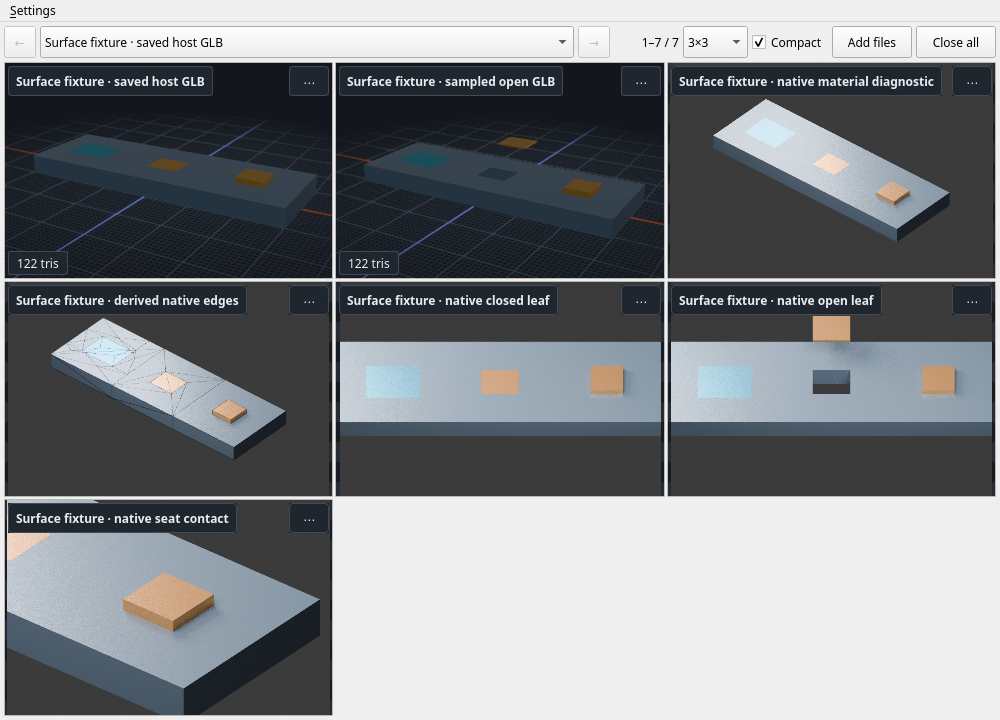

# Surface fixture connection

`connect_surface_fixture.py` connects the existing Asset Workshop construct's
closed/open host GLBs and five owner-generated diagnostic PNGs. It delegates all
geometry, native/export readback, receipts and publication to
`asset-workshop/constructs/surface-ownership`; it contains no geometry operator.
Read that construct's current contract and canonical pin before using it.

Connect quietly before authoring, including when the outputs are still missing:

```sh
python3 examples/connect_surface_fixture.py
```

This changes only the seven `workshop-surface-fixture-*` registrations. It leaves
the window, selection, layout and inspection settings in place. It neither builds
nor opens a desktop window. Build manually through the owner's finite wrapper:

```sh
~/workspace/asset-workshop/constructs/surface-ownership/scripts/build.sh --capture
```

Or reconnect with `--generate` to let the model view own the builder:

```sh
python3 examples/connect_surface_fixture.py --generate
```

Only a shown model view may run the generator. The five PNGs and open-pose GLB
watch published outputs. Do not also run the builder manually while that view
owns it. Recipe/declaration, material definitions in `build_fixture.py`, wrapper,
publication/receipt helpers, canonical loader/pin and the two pinned implementation
modules are watched; generated outputs are excluded. The finite command invokes
the prescribed shared Podman wrapper through the construct. The explicit 1,200-second timeout covers
its optional CPU diagnostic captures; override it only for a known finite run.

Defaults use the owners' normal checkouts under `~/workspace`. For isolated
worktrees, pass `--workshop`, `--preview`, `--tools` and `--runner` explicitly.
Their corresponding environment variables also work. `--print-plan` prints the
exact argument lists and watches without connecting or executing anything.

After the owner publishes `manifest.json` last, check the accepted file set:

```sh
python3 examples/connect_surface_fixture.py --check
```

This checks source/pin/export/native identity and every listed file's bytes. A
mixed revision or missing proof view fails. It does not rerun the geometry audit
or validate the full `surface-ownership/v1` schema. Read the owner's saved
`surface-fixture.audit.json` and byte-bound receipt for that separate verdict.
The open pose has a separate invalidated receipt and sampled aperture audit;
neither two pose snapshots nor a Live label prove the complete animation sweep.

The PNGs are **Cycles CPU native diagnostics** of the matching saved native
geometry and recorded pose. `cut-edges.png` adds derived diagnostic wire geometry
outside the accepted GLB. Camera, lights, resolution and pose are recorded in the
owner's manifest. These images help inspect material placement, aperture edges,
leaf poses and seat contact. They are not imported-GLB or hardware game appearance
proof. The actual closed/open GLBs remain connected separately for inspection;
engine-specific materials still require an owning-engine capture.

The connector never selects entries, changes settings, accepts a geometry verdict,
publishes externally or cleans another task's state. Remove only the seven IDs
you own when the connection is no longer useful. See the
[agent flow](../docs/agent-flow.md) for the general authoring contract.

The example was loaded in one isolated Gamescope headless session on an NVIDIA
GeForce RTX 2080 Ti. Both saved GLBs and all five owner PNGs loaded; hiding the
window released the views and the isolated process exited. The
[capture metadata](surface_fixture_capture.json) binds this screenshot to its
exact model/native/proof bytes and canonical pin. It records the separate saved
geometry audit's bounded scope and the two-pose motion limit.



The connector groups all fixture views under its stable ID prefix (overridable
with `ASSET_PREVIEW_PROJECT_ID` / `ASSET_PREVIEW_PROJECT_LABEL`). The saved host
model is current; open/closed/contact diagnostic views use `--no-current`.
Project pane updates preserve the user's global selection and layout.
